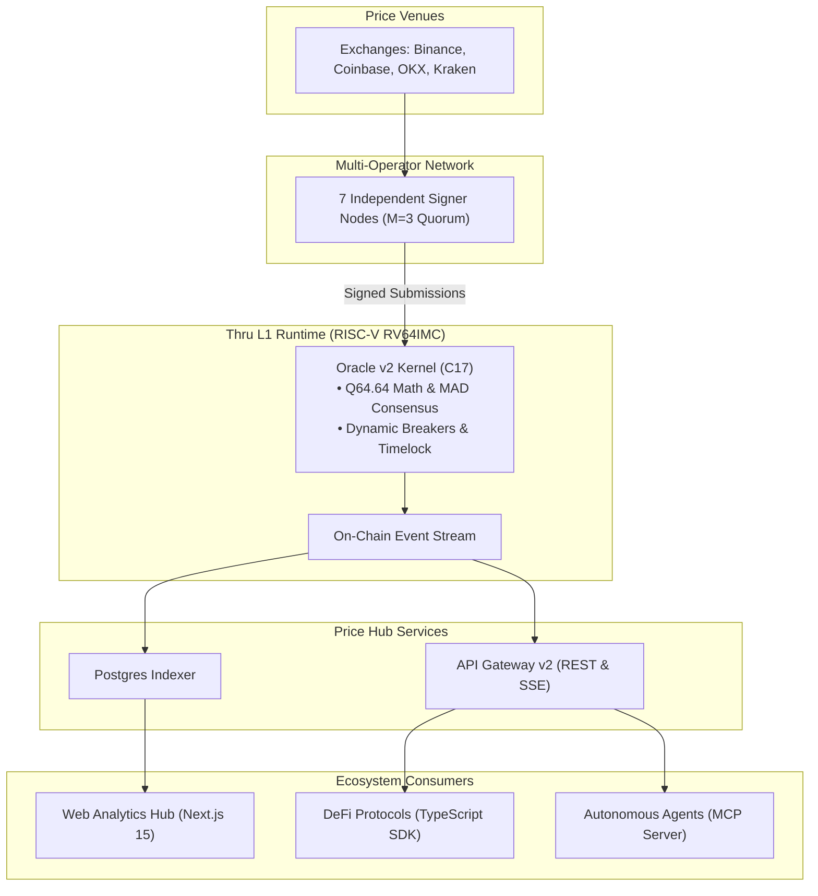

# Thru Price Hub

[](https://github.com/Assassinprotocol/Thru-quant-core/actions/workflows/ci.yml)


-brightgreen?style=flat-square)


Deterministic Q64.64 fixed-point market data oracle and risk primitives for Thru Network (RISC-V RV64IMC), featuring on-chain multi-operator median consensus, outlier-robust filtering, high-throughput REST/SSE gateway, and zero-dependency TypeScript SDK.

---

## 1. System Architecture



| Layer | Component | Language / Runtime | Primary Scope |
|---|---|:---:|---|
| **Contract Core** | `src/thru_math.c`, `src/v2/` | C17 (RV64IMC) | Checked fixed-point arithmetic, median consensus, dynamic breakers |
| **Consumer Headers** | `include/thru_oracle_consumer.h` | C17 / Rust FFI | Zero-overhead safety kit for downstream DeFi protocols |
| **Publisher Engine** | `feeder/`, `cmd/api/` | Go 1.23+ | Multi-venue WebSocket ingestion, WAL replay, quorum dispatch |
| **State Indexer** | `indexer/` | TypeScript / Node | Event ingestion, continuous checkpoint recovery, rolling volatility |
| **API Gateway** | `gateway/` | Fastify / TypeScript | High-throughput REST & SSE endpoints with Prometheus telemetry |
| **Client SDK** | `sdk/` | TypeScript | Dual v1/v2 zero-allocation binary decoders (`@thru-quant/core-sdk`) |
| **Operator Portal** | `web/` | Next.js 15 | Real-time analytics, operator leaderboard, provenance verification |
| **Agent Interface** | `mcp/`, `llms.txt` | TypeScript / JSON-RPC | Model Context Protocol server for autonomous trading agents |

---

## 2. Quickstart

### Consuming Feeds via TypeScript SDK

```typescript
import { OracleV2Client } from "@thru-quant/core-sdk";

const client = new OracleV2Client({
  gatewayUrl: "http://localhost:8080",
});

// Fetch canonical Core-6 price with asymmetric confidence bounds
const btc = await client.getLatestPrice("BTC/USD");
console.log(`BTC: $${btc.price.toFixed(2)} (±${btc.confidenceBps} bps)`);

// Subscribe to real-time server-sent events (SSE)
const unsubscribe = client.watchFeed("BTC/USD", (update) => {
  console.log(`Slot ${update.publishSlot}: $${update.price}`);
});
```

### Querying Feeds via REST / SSE

```bash
# Query active feed for BTC/USD
curl -s http://localhost:8080/v2/feeds/BTC | jq .

# Inspect Prometheus operator and price metrics
curl -s http://localhost:8080/metrics | grep thru_oracle
```

---

## 3. Trust Tiers & Verification Hierarchy

Claims in this repository adhere strictly to the **Trust Ladder**:

| Tier | Designation | Consensus Model | Current Status |
|:---:|---|---|:---:|
| **T0** | Single-Operator | 1 publisher key, off-chain multi-venue median | Verified (Betanet) |
| **T1** | Multi-Key | $\ge 3$ independent keys/hosts, on-chain median | Verified (v2 Sandbox) |
| **T2** | Multi-Operator | 7 external independent publishers ($M=3$ quorum) | **Active (v1.0.0, Score 87.2/100)** |
| **T3** | Accountable Production | Slashing / bonding, formal verification, 60-day SLO | Post-Mainnet Roadmap |

- Audit scorecard & remediation: [docs/audit/audit-scorecard.md](docs/audit/audit-scorecard.md)
- Invariants & threat model: [docs/invariants-v2.md](docs/invariants-v2.md)
- Formal evidence registry: [docs/claims.md](docs/claims.md)
- Live component status: [STATUS.md](STATUS.md)

---

## 4. Local Build & Verification

```bash
# 1. Run core unit tests with ASan & UBSan
make test

# 2. Run golden math vectors and invariant suites
make test-math-golden test-v2-contracts

# 3. Run Gateway, Indexer, and SDK regression suites
make test-indexer test-gateway test-sdk

# 4. Verify on-chain claims and documentation integrity
make verify-claims lint-claims check-links

# 5. Compile RISC-V RV64IMC contract target (< 32 KB)
make build-rv64
```

---

## 5. Scope Boundaries

- **Asset Universe:** Focused strictly on **Core-6** (`BTC/USD`, `ETH/USD`, `SOL/USD`, `USDT/USD`, `USDC/USD`, `WTHRU/USD`). Expansion follows formal protocol onboarding.
- **CLOB Matching Engine:** Quarantined as a research prototype under `research/clob/`. It models price-time priority matching with zero token custody or escrow.

---

## 6. License

Licensed under the MIT License. See [LICENSE](LICENSE) and [docs/facts/licensing.md](docs/facts/licensing.md).
