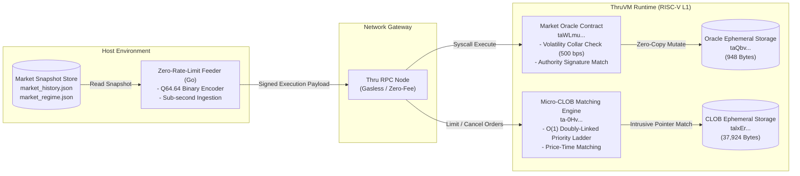

# Thru Quant Core

[](https://github.com/Assassinprotocol/Thru-quant-core/actions/workflows/ci.yml)


An early-stage, auditable quantitative finance prototype engineered in C for the **Thru Network** Layer-1 blockchain, executing natively on ThruVM (RISC-V RV64IMC). Provides a verifiable market-data oracle, deterministic Q64.64 risk math, and a reference limit-order matching engine.

---

## 1. Executive Summary & Verification Matrix

`thru-quant-core` focuses on verifiable market data and deterministic execution primitives:

1. **Deterministic Q64.64 Fixed-Point Mathematics**: Defined two's-complement limb operations, Newton-Raphson square root, and polynomial approximations executing strictly within 64-bit ALU bounds without undefined behavior.
2. **Institutional Market Oracle**: High-density packed quote storage for 32 crypto assets featuring cryptographic fee-payer authority binding, timestamp provenance, and a persistent Volatility Circuit Breaker restricting single-slot anomalies ($\le 500$ bps).
3. **Reference Micro-CLOB Matching Engine**: A research-grade continuous limit orderbook utilizing an intrusive doubly-linked price-time priority ladder, demonstrating deterministic $O(1)$ best-bid-and-offer (BBO) lookup.
4. **Streaming Feeder Prototype**: A local quote aggregator ingesting market history and streaming packed Q64.64 payloads on-chain with source-timestamp provenance.

### 6-Tier Verification Status Matrix

All modules are classified according to strict proof requirements:

| Module / Primitive | Status Tier | Public Code | Host Tested (ASan) | Target Built (RV64) | On-Chain Alphanet | Production Settlement |
|---|:---:|:---:|:---:|:---:|:---:|:---:|
| **Q64.64 Math Core** | `Host-tested` / `Target-built` | Yes | Yes | Yes | N/A | N/A |
| **Market Oracle Program** | `Alphanet-verified` | Yes | Yes | Yes | Yes (Slot 7743340) | Planned |
| **Circuit Breaker Lifecycle** | `Host-tested` / `Alphanet-verified` | Yes | Yes | Yes | Yes (Tested) | Planned |
| **Binary Memory Decoder (Go)** | `Host-tested` / `Runtime-verified` | Yes | Yes | N/A | Yes (Decodes Slot 7743340) | Planned |
| **Reference CLOB Engine** | `Target-built` / `Alphanet-verified` | Yes | Yes | Yes | Yes (Slot 7743774) | Out-of-Scope (Research) |
| **Token Escrow & Custody** | `Not Implemented` | No | No | No | No | Out-of-Scope |

> [!NOTE]
> **Explicit CLOB Scope Boundary:** The CLOB orderbook is implemented strictly as a **Deterministic Reference Matching Engine (Research Prototype)**. It models price-time priority matching in memory, but does not implement balance custody, asset escrow, token transfers, or financial settlement. See [docs/claims.md](docs/claims.md) for full evidence registry.

---

## 2. Core Modules

### 2.1 Fixed-Point Mathematics Engine (`src/thru_math.c`, `include/thru_math.h`)

All price vectors, quantity ratios, and volatility collars are calculated in signed 128-bit fixed-point format (`q64_t`), represented by 64 bits of integer magnitude and 64 bits of fractional precision:

$$\text{Value} = \frac{X}{2^{64}}$$

- **Safe Limb Division (`q64_div`)**: Replaces naive 128-bit shift division with a three-stage limb-division algorithm ($q_{\text{int}} = ua / ub$, $rem = ua \pmod{ub}$, $q_{\text{frac}} = (rem \cdot 2^{64}) / ub$) to prevent MSB truncation for operands $\ge 1.0$.
- **Newton-Raphson Square Root (`q64_sqrt`)**: Computes convergence iteratively via $y_{k+1} = \frac{1}{2}(y_k + \frac{x}{y_k})$ up to machine epsilon, eliminating bit-shift truncation present in classical integer square root algorithms.
- **Transcendental Functions**: Taylor polynomial approximation for natural exponential ($\exp(x)$), natural logarithm ($\ln(x)$), and standard trigonometric functions.

### 2.2 Micro-CLOB Orderbook (`src/clob_engine.c`, `src/clob_engine.h`)

Unlike conventional linear-scan or tree-based orderbooks that suffer from variable memory lookups and high gas costs, the Micro-CLOB orderbook allocates a packed, contiguous memory segment (`clob_state_t`, 37,924 bytes) containing sorted doubly-linked lists for bids and asks:

- **Intrusive Node Traversal**: Each order struct (`clob_order_t`) contains `prev_idx` and `next_idx` pointers.
- **$O(1)$ BBO Access**: The book state maintains `best_bid_idx` (highest active bid) and `best_ask_idx` (lowest active ask).
- **Price-Time Priority (FIFO)**: Limit orders with identical price levels are appended chronologically behind existing orders at that price level.
- **Anti-DoS Gate**: Enforces a non-zero `min_notional` threshold on incoming orders to mitigate orderbook saturation attacks.

### 2.3 Market Oracle & Volatility Circuit Breaker (`src/market_oracle.c`, `src/market_oracle.h`)

The Market Oracle maintains an on-chain packed state array (`oracle_account_data_t`, 948 bytes) for up to 32 assets:

- **Cryptographic Authority Binding**: Update instructions require that the transaction fee-payer pubkey strictly matches `authority_pubkey` initialized in the state.
- **Volatility Collar (Circuit Breaker)**: Evaluates incoming price quotes against existing state quotes. If any single asset exhibits a price deviation exceeding `MAX_ALLOWED_DEVIATION_BPS` (500 bps / 5.0%), the transaction immediately reverts with error `0x2007` (`ORACLE_ERR_CIRCUIT_BREAKER`) and sets `circuit_breaker_active = 1`.

---

## 3. Algorithmic Complexity

| Operation | Time Complexity | Space Complexity | Description |
| :--- | :---: | :---: | :--- |
| **BBO Head Query** | $O(1)$ | $O(1)$ | Direct pointer access to `best_bid_idx` / `best_ask_idx` |
| **Resting Order Placement** | $O(N)$ | $O(1)$ | Insertion into sorted doubly-linked list ($N \le 256$, FIFO tie-breaker) |
| **Crossing Match Clearance** | $O(K)$ | $O(1)$ | Traversing and clearing $K$ matched price levels from BBO head |
| **Order Cancellation** | $O(N)$ | $O(1)$ | Sequential ID lookup followed by $O(1)$ pointer unlinking |
| **Oracle Batch Update** | $O(M)$ | $O(1)$ | Linear scan over updated symbols ($M \le 32$) with volatility collar check |

---

## 4. Memory Layout & Sizing Specification

All data structures use the `__attribute__((packed))` directive to eliminate compiler padding, guarantee deterministic byte offsets across target architectures, and facilitate zero-copy direct memory access (`tsdk_get_account_data_ptr`).

### 4.1 Market Oracle State (`oracle_account_data_t`)

Total Size: **948 bytes**

```
+-----------------------------------------------------------------------------------------+
| Offset (B) | Field                   | Type              | Size (B) | Description       |
+------------+-------------------------+-------------------+----------+-------------------+
| 0          | version                 | uint32_t          | 4        | Protocol version  |
| 4          | authority_pubkey        | uint8_t[32]       | 32       | Fee-payer signer  |
| 36         | circuit_breaker_active  | uint8_t           | 1        | Circuit breaker   |
| 37         | _reserved               | uint8_t[3]        | 3        | Alignment pad     |
| 40         | regime_id               | uint32_t          | 4        | Macro regime ID   |
| 44         | last_update_ts          | uint32_t          | 4        | Unix timestamp    |
| 48         | entry_count             | uint32_t          | 4        | Active symbols    |
| 52         | entries[32]             | oracle_entry_t[32]| 896      | 28 bytes / quote  |
+-----------------------------------------------------------------------------------------+
```

### 4.2 CLOB Orderbook State (`clob_state_t`)

Total Size: **37,924 bytes**

```
+-----------------------------------------------------------------------------------------+
| Offset (B) | Field                   | Type              | Size (B) | Description       |
+------------+-------------------------+-------------------+----------+-------------------+
| 0          | version                 | uint32_t          | 4        | Protocol version  |
| 4          | market_type             | uint8_t           | 1        | Book enum         |
| 5          | _reserved               | uint8_t[3]        | 3        | Alignment pad     |
| 8          | min_notional            | uint64_t          | 8        | Anti-DoS gate     |
| 16         | next_order_id           | uint64_t          | 8        | Monotonic counter |
| 24         | best_bid_idx            | int16_t           | 2        | BBO Bid pointer   |
| 26         | best_ask_idx            | int16_t           | 2        | BBO Ask pointer   |
| 28         | bid_count               | uint32_t          | 4        | Active bid count  |
| 32         | ask_count               | uint32_t          | 4        | Active ask count  |
| 36         | bids[256]               | clob_order_t[256] | 18,944   | 74 bytes / order  |
| 18,980     | asks[256]               | clob_order_t[256] | 18,944   | 74 bytes / order  |
+-----------------------------------------------------------------------------------------+
```

---

## 5. Architectural Topology

### 5.1 Host-to-L1 Data Pipeline



### 5.2 Micro-CLOB Doubly-Linked Priority Ladder

```mermaid
flowchart TD
    subgraph StateHeader ["Book Header Pointers"]
        BBO_BID["best_bid_idx: Index of Highest Price Bid"]
        BBO_ASK["best_ask_idx: Index of Lowest Price Ask"]
    end

    subgraph SortedBids ["Sorted Bids Ladder (Descending Order)"]
        B1["Slot 0: $2,500 | Qty: 6\nprev: -1 | next: 2"]
        B2["Slot 2: $2,495 | Qty: 15\nprev: 0 | next: -1"]
        B1 <-->|Doubly Linked| B2
    end

    subgraph SortedAsks ["Sorted Asks Ladder (Ascending Order)"]
        A1["Slot 1: $2,502 | Qty: 8\nprev: -1 | next: 3"]
        A2["Slot 3: $2,510 | Qty: 20\nprev: 1 | next: -1"]
        A1 <-->|Doubly Linked| A2
    end

    BBO_BID -->|O(1) Head Access| B1
    BBO_ASK -->|O(1) Head Access| A1
    CrossingOrder["Incoming Crossing Order (e.g. ASK $2,500)"] -->|Instant Match O(1)| B1
```

---

## 6. Verified Live Deployment Registry (Thru Alphanet)

Both programs and their ephemeral storage accounts are deployed, initialized, and verified on the Thru Network Alphanet:

| Component | Account Address | Type / Dimensions | Verification Status |
| :--- | :--- | :--- | :--- |
| **Market Oracle Program** | `taWLmuEWcY7nikkn1JB1Whl5nBG1YqWj0oKJMVL8bPbdfR` | Program Executable | Verified & Upgraded |
| **Market Oracle ABI** | `ta5vSXl_w-ELG9NgGLQFkWhBgbbN0zfjcBNy3QzeYtNBZ4` | ABI Metadata | Reflected on ThruScan |
| **Market Oracle Storage** | `taQbv-8fTNz3pEM9T5y0Ik61jtDV7BWMdmJFjh0c3FvwPN` | Ephemeral Storage (948 B) | Initialized (`Seq: 2`) |
| **CLOB Engine Program** | `ta-0HvoxEgLocbOZNZ9esb7A9qGfKvdwPeOr1eHtDRhP37` | Program Executable | Verified & Upgraded |
| **CLOB Engine ABI** | `tacZqSWnYV00RwdYVkvkZU-7CEC0eGqAgM5SgknMVjH0Xb` | ABI Metadata | Reflected on ThruScan |
| **CLOB Engine Storage** | `talxErrmxdDsQU7VFoIo4l7NVs0q9RgK6dd4Gc0HV59xbU` | Ephemeral Storage (37.9 KB) | Initialized (`Seq: 3`) |
| **Signer Authority / Fee Payer**| `taIWL8iro1Jt8sNChWGgupC5tzqewzfjfSzp2pegCWYm0E` | Native EOA (`0xhansen`) | Active |

---

## 7. ThruVM Runtime Specification & Syscall Semantics

Developing and invoking native C programs on ThruVM requires strict compliance with kernel syscall invariants:

1. **Picolibc Anonymous Stack Segment Requirement**:
   - The CLI `thru txn execute` defaults `--memory-units` to `0`. During program entry, picolibc `_start` invokes Syscall 0 (`TN_SYSCALL_CODE_SET_ANONYMOUS_SEGMENT_SZ`) to allocate the stack segment.
   - If invoked with `--memory-units 0`, the runtime immediately aborts with error `-26` (`0xFFFFFFFFFFFFFFE6`).
   - **Requirement**: Always provide `--memory-units 5000` (or greater) and `--state-units 10` on transaction invocations.

2. **Syscall Ordering Invariant for Storage Allocation**:
   - `tsys_set_account_data_writable(acc_idx)` **must be called prior to** `tsys_account_resize(acc_idx, sz)`.
   - Invoking resize on an account whose data segment has not been designated writable causes the VM syscall to abort with error `-10` (`Account not writable`).

3. **Dynamic PDA Derivation**:
   - Programs can generate deterministic ephemeral storage accounts dynamically via `tsys_account_create_ephemeral(acc_idx, seed)` without requiring pre-computed Merkle inclusion state proofs from the client.

---

## 8. Build, Simulation & Test Guide

### 8.1 Toolchain Prerequisites
- Thru CLI (`thru 0.4.1+`)
- RISC-V Cross Compiler (`thru dev toolchain install`)
- Thru C SDK (`thru dev sdk install c`)

### 8.2 Compiling Contracts to RISC-V RV64IMC
```bash
make
```
Compiled ELF and flat binaries are emitted to `build/thruvm/bin/`:
- `market_oracle_c.bin` (14,104 bytes)
- `clob_engine_c.bin` (15,863 bytes)

### 8.3 Executing Host Architectural Test Suite
```bash
make test
```
The test runner builds and executes:
1. `tests/test_thru_math`: Validates safe limb-division, fixed-point multiplication, Newton-Raphson square roots, and boundary edge cases.
2. `tests/test_simulation`: Validates price-time priority matching, intrusive doubly-linked list operations, and the 500 bps volatility circuit breaker.
3. `tests/test_contracts`: Validates 14 real contract entrypoint lifecycle scenarios including anti-state wipe and authorized recovery.

### 8.4 Clean-Clone Reproduction & Empirical Benchmarks
To run the full end-to-end verification suite across all C harnesses, Go decoders, standalone binaries, and empirical latency benchmarks:
```bash
# Execute single-command clean verification
bash scripts/verify_reproduce.sh

# Run empirical Q64.64 math and Go binary decoding benchmarks
make bench-math
make bench-api
```
See [docs/benchmarks.md](docs/benchmarks.md) for empirical latency and throughput profiles, and [docs/runbook.md](docs/runbook.md) for operator runbooks.

---

## 9. Local Streaming Feeder Prototype

The streaming feeder reads local market state snapshots and broadcasts packed Q64.64 vectors to Thru Network:

```bash
# Set market data path (or pass via --data-dir)
export MARKET_DATA_DIR="./data"

# Build feeder binary
go build -o feeder/feeder feeder/main.go

# Execute continuous price update daemon
./feeder/feeder \
  --program taWLmuEWcY7nikkn1JB1Whl5nBG1YqWj0oKJMVL8bPbdfR \
  --account taQbv-8fTNz3pEM9T5y0Ik61jtDV7BWMdmJFjh0c3FvwPN \
  --fee-payer 0xhansen \
  --interval 5s
```

---

## 10. Developer API Daemon & Live Telemetry Console

The Go API service decodes the on-chain `oracle_account_data_t` binary state and exposes high-performance REST and SSE endpoints alongside an institutional-grade dark developer cockpit:

```bash
# Run unit and integration tests (validates on-chain binary decoding)
make test-api

# Build standalone API binary
make build-api

# Run API daemon & web console on port 8080
make run-api
```

### 10.1 Endpoints Specification

| Method | Endpoint | Description |
| :---: | :--- | :--- |
| `GET` | `/health` | Liveness probe verifying process health (`healthy`, uptime). Always HTTP 200. |
| `GET` | `/ready` | Operational readiness probe (`ready`, `feed_age_seconds`). Returns HTTP 200 (healthy) or HTTP 503 (`stale` > 120s, `circuit_breaker_active`, `uninitialized`). |
| `GET` | `/v1/status` | Network provenance, target slot, authority pubkey, operational diagnostic counters, and memory layout specs. |
| `GET` | `/v1/oracle/latest` | Decoded snapshot of 28 crypto assets with float prices, Q64 hex, and volatility bps. |
| `GET` | `/v1/oracle/history` | Rolling 30-sample price buffer per symbol for charting. |
| `GET` | `/v1/stream` | Server-Sent Events (SSE) push stream with 15s keepalive. |

### 10.2 Live Web Console
Visit `http://localhost:8080/` to access the live dark telemetry dashboard featuring real-time quote feeds, tick flash indicators, Q64 hex inspector, and an in-memory reference CLOB sandbox.

---

## 11. License

This project is licensed under the MIT License. See [LICENSE](LICENSE) for details.
