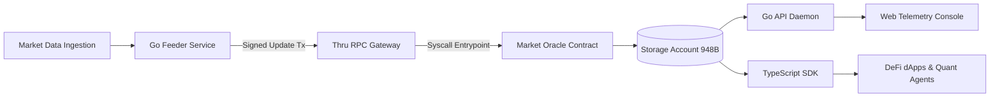
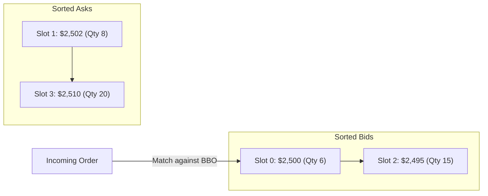

# Thru Quant Core

[](https://github.com/Assassinprotocol/Thru-quant-core/actions/workflows/ci.yml)


A high-performance market-data oracle and deterministic risk engine built in C for the **Thru Network** (RISC-V RV64IMC), paired with a zero-dependency TypeScript SDK and local Go API daemon.

---

## 1. Overview & Verification Status

`thru-quant-core` provides verifiable on-chain market data and deterministic execution primitives:

1. **Deterministic Q64.64 Arithmetic**: 128-bit fixed-point math with Newton-Raphson square roots and checked division running natively on 64-bit ALU registers.
2. **On-Chain Market Oracle**: Packed 948-byte storage account tracking up to 32 assets with cryptographic authority binding, freshness timestamps, and an on-chain volatility circuit breaker (500 bps limit).
3. **Deterministic Reference Matching Engine**: Continuous limit orderbook research prototype using an intrusive doubly-linked price-time priority ladder with $O(1)$ BBO access.
4. **Multi-Runtime Integration**: A local Go feeder/daemon and a zero-dependency TypeScript SDK (`@thru-quant/core-sdk`) with exact arbitrary-precision BigInt math.

### Component Maturity & Verification Status

| Module / Component | Status Tier | Host Tested (ASan) | Target Built (RV64) | On-Chain Alphanet | Production Ready |
|---|:---:|:---:|:---:|:---:|:---:|
| **Q64.64 Math Core** | `Target-built` | Yes | Yes | N/A | N/A |
| **Market Oracle Program** | `Alphanet-verified` | Yes | Yes | Yes (Slot 7743340) | Planned |
| **Circuit Breaker Lifecycle** | `Alphanet-verified` | Yes | Yes | Yes (Slot 7743340) | Planned |
| **Binary Memory Decoder (Go)** | `Runtime-verified` | Yes | N/A | Yes (Verified) | Planned |
| **TypeScript SDK (@thru-quant/core-sdk)** | `Production-packaged` | Yes | N/A | Yes (Cross-lang verified) | Planned |
| **Autonomous Risk Agent** | `Verified-Consumer` | Yes | N/A | Yes (Dry-run verified) | Planned |
| **Reference CLOB Engine** | `Target-built` | Yes | Yes | Yes (Slot 7743774) | Out-of-Scope (Research) |
| **Token Escrow & Custody** | `Not Implemented` | No | No | No | Out-of-Scope |

> [!NOTE]
> **Explicit CLOB Scope Boundary:** The CLOB orderbook is implemented strictly as a **Deterministic Reference Matching Engine (Research Prototype)**. It models price-time priority matching in memory, but does not implement balance custody, asset escrow, token transfers, or financial settlement. See [docs/claims.md](docs/claims.md) for full evidence registry.

---

## 2. Core Modules

### 2.1 Fixed-Point Mathematics Engine (`src/thru_math.c`, `include/thru_math.h`)

All price vectors, quantity ratios, and volatility collars are calculated in signed 128-bit fixed-point format (`q64_t`), represented by 64 bits of integer magnitude and 64 bits of fractional precision:

$$\text{Value} = \frac{X}{2^{64}}$$

- **Safe Limb Division (`q64_div`)**: Replaces naive 128-bit shift division with a three-stage limb-division algorithm ($q_{\text{int}} = ua / ub$, $rem = ua \pmod{ub}$, $q_{\text{frac}} = (rem \cdot 2^{64}) / ub$) to prevent MSB truncation for operands $\ge 1.0$.
- **Newton-Raphson Square Root (`q64_sqrt`)**: Computes convergence iteratively via $y_{k+1} = \frac{1}{2}(y_k + \frac{x}{y_k})$ up to machine epsilon, eliminating bit-shift truncation present in classical integer square root algorithms.
- **Transcendental Functions**: Taylor polynomial approximation for natural exponential ($\exp(x)$), natural logarithm ($\ln(x)$), and standard trigonometric functions.

### 2.2 Micro-CLOB Orderbook (`src/clob_engine.c`, `src/clob_engine.h`)

Unlike conventional linear-scan or tree-based orderbooks that suffer from variable memory lookups and high gas costs, the Micro-CLOB orderbook allocates a packed, contiguous memory segment (`clob_state_t`, 37,924 bytes) containing sorted doubly-linked lists for bids and asks:

- **Intrusive Node Traversal**: Each order struct (`clob_order_t`) contains `prev_idx` and `next_idx` pointers.
- **$O(1)$ BBO Access**: The book state maintains `best_bid_idx` (highest active bid) and `best_ask_idx` (lowest active ask).
- **Price-Time Priority (FIFO)**: Limit orders with identical price levels are appended chronologically behind existing orders at that price level.
- **Anti-DoS Gate**: Enforces a non-zero `min_notional` threshold on incoming orders to mitigate orderbook saturation attacks.

### 2.3 Market Oracle & Volatility Circuit Breaker (`src/market_oracle.c`, `src/market_oracle.h`)

The Market Oracle maintains an on-chain packed state array (`oracle_account_data_t`, 948 bytes) for up to 32 assets:

- **Cryptographic Authority Binding**: Update instructions require that the transaction fee-payer pubkey strictly matches `authority_pubkey` initialized in the state.
- **Volatility Collar (Circuit Breaker)**: Evaluates incoming price quotes against existing state quotes. If any single asset exhibits a price deviation exceeding `MAX_ALLOWED_DEVIATION_BPS` (500 bps / 5.0%), the contract sets `circuit_breaker_active = 1` and commits the pause state cleanly via `tsdk_return(TSDK_SUCCESS)`. While active, subsequent price updates are blocked with `ORACLE_ERR_CIRCUIT_BREAKER` (`0x2007`) until an authorized `RESUME` instruction is submitted.

---

## 3. Algorithmic Complexity

| Operation | Time Complexity | Space Complexity | Description |
| :--- | :---: | :---: | :--- |
| **BBO Head Query** | $O(1)$ | $O(1)$ | Direct pointer access to `best_bid_idx` / `best_ask_idx` |
| **Resting Order Placement** | $O(N)$ | $O(1)$ | Insertion into sorted doubly-linked list ($N \le 256$, FIFO tie-breaker) |
| **Crossing Match Clearance** | $O(K)$ | $O(1)$ | Traversing and clearing $K$ matched price levels from BBO head |
| **Order Cancellation** | $O(N)$ | $O(1)$ | Sequential ID lookup followed by $O(1)$ pointer unlinking |
| **Oracle Batch Update** | $O(M)$ | $O(1)$ | Linear scan over updated symbols ($M \le 32$) with volatility collar check |

---

## 4. Memory Layout & Sizing Specification

All data structures use the `__attribute__((packed))` directive to eliminate compiler padding, guarantee deterministic byte offsets across target architectures, and facilitate zero-copy direct memory access (`tsdk_get_account_data_ptr`).

### 4.1 Market Oracle State Layout (`oracle_account_data_t`, 948 Bytes)

| Offset (B) | Field | Type | Size (B) | Description |
| :---: | :--- | :--- | :---: | :--- |
| `0` | `version` | `uint32_t` | 4 | Protocol version (must equal 1) |
| `4` | `authority_pubkey` | `uint8_t[32]` | 32 | Authorized fee-payer public key |
| `36` | `circuit_breaker_active` | `uint8_t` | 1 | Circuit breaker state flag (1 = active/halted) |
| `37` | `_reserved` | `uint8_t[3]` | 3 | Reserved alignment padding |
| `40` | `regime_id` | `uint32_t` | 4 | Market regime identifier (0 to 3) |
| `44` | `last_update_ts` | `uint32_t` | 4 | Unix timestamp of most recent update |
| `48` | `entry_count` | `uint32_t` | 4 | Number of active symbols ($N \le 32$) |
| `52` | `entries[32]` | `oracle_entry_t[32]` | 896 | Array of 32 quote entries (28 bytes each) |

### 4.2 CLOB Orderbook State Layout (`clob_state_t`, 37,924 Bytes)

| Offset (B) | Field | Type | Size (B) | Description |
| :---: | :--- | :--- | :---: | :--- |
| `0` | `version` | `uint32_t` | 4 | Protocol version |
| `4` | `market_type` | `uint8_t` | 1 | Market type identifier |
| `5` | `_reserved` | `uint8_t[3]` | 3 | Alignment padding |
| `8` | `min_notional` | `uint64_t` | 8 | Anti-DoS minimum notional threshold |
| `16` | `next_order_id` | `uint64_t` | 8 | Monotonic order counter |
| `24` | `best_bid_idx` | `int16_t` | 2 | Head pointer for sorted bids (-1 = empty) |
| `26` | `best_ask_idx` | `int16_t` | 2 | Head pointer for sorted asks (-1 = empty) |
| `28` | `bid_count` | `uint32_t` | 4 | Active resting bid count |
| `32` | `ask_count` | `uint32_t` | 4 | Active resting ask count |
| `36` | `bids[256]` | `clob_order_t[256]` | 18,944 | Array of 256 bid slots (74 bytes each) |
| `18,980` | `asks[256]` | `clob_order_t[256]` | 18,944 | Array of 256 ask slots (74 bytes each) |

---

## 5. Architectural Topology

### 5.1 End-to-End Data Pipeline



### 5.2 Reference CLOB Priority Matching Ladder



---

## 6. Verified Live Deployment Registry (Thru Alphanet)

Both programs and their ephemeral storage accounts are deployed, initialized, and verified on the Thru Network Alphanet:

| Component | Account Address | Type / Dimensions | Verification Status |
| :--- | :--- | :--- | :--- |
| **Market Oracle Program** | `taWLmuEWcY7nikkn1JB1Whl5nBG1YqWj0oKJMVL8bPbdfR` | Program Executable | Verified & Upgraded |
| **Market Oracle ABI** | `ta5vSXl_w-ELG9NgGLQFkWhBgbbN0zfjcBNy3QzeYtNBZ4` | ABI Metadata | Reflected on ThruScan |
| **Market Oracle Storage** | `taQbv-8fTNz3pEM9T5y0Ik61jtDV7BWMdmJFjh0c3FvwPN` | Ephemeral Storage (948 B) | Initialized (`Seq: 2`) |
| **CLOB Engine Program** | `ta-0HvoxEgLocbOZNZ9esb7A9qGfKvdwPeOr1eHtDRhP37` | Program Executable | Verified & Upgraded |
| **CLOB Engine ABI** | `tacZqSWnYV00RwdYVkvkZU-7CEC0eGqAgM5SgknMVjH0Xb` | ABI Metadata | Reflected on ThruScan |
| **CLOB Engine Storage** | `talxErrmxdDsQU7VFoIo4l7NVs0q9RgK6dd4Gc0HV59xbU` | Ephemeral Storage (37.9 KB) | Initialized (`Seq: 3`) |
| **Signer Authority / Fee Payer**| `taIWL8iro1Jt8sNChWGgupC5tzqewzfjfSzp2pegCWYm0E` | Native EOA (`0xhansen`) | Active |

---

## 7. ThruVM Runtime Specification & Syscall Semantics

Developing and invoking native C programs on ThruVM requires strict compliance with kernel syscall invariants:

1. **Picolibc Anonymous Stack Segment Requirement**:
   - The CLI `thru txn execute` defaults `--memory-units` to `0`. During program entry, picolibc `_start` invokes Syscall 0 (`TN_SYSCALL_CODE_SET_ANONYMOUS_SEGMENT_SZ`) to allocate the stack segment.
   - If invoked with `--memory-units 0`, the runtime immediately aborts with error `-26` (`0xFFFFFFFFFFFFFFE6`).
   - **Requirement**: Always provide `--memory-units 5000` (or greater) and `--state-units 10` on transaction invocations.

2. **Syscall Ordering Invariant for Storage Allocation**:
   - `tsys_set_account_data_writable(acc_idx)` **must be called prior to** `tsys_account_resize(acc_idx, sz)`.
   - Invoking resize on an account whose data segment has not been designated writable causes the VM syscall to abort with error `-10` (`Account not writable`).

3. **Ephemeral Storage Account Creation**:
   - Programs can generate deterministic ephemeral storage accounts dynamically via `tsys_account_create_ephemeral(acc_idx, seed)` without requiring pre-computed Merkle inclusion state proofs from the client.

---

## 8. Build, Simulation & Test Guide

### 8.1 Toolchain Prerequisites
- Thru CLI (`thru 0.4.1+`)
- RISC-V Cross Compiler (`thru dev toolchain install`)
- Thru C SDK (`thru dev sdk install c`)

### 8.2 Compiling Contracts to RISC-V RV64IMC
```bash
make
```
Compiled ELF and flat binaries are emitted to `build/thruvm/bin/`:
- `market_oracle_c.bin` (14,104 bytes)
- `clob_engine_c.bin` (15,863 bytes)

### 8.3 Executing Host Architectural Test Suite
```bash
make test
```
The test runner builds and executes:
1. `tests/test_thru_math`: Validates safe limb-division, fixed-point multiplication, Newton-Raphson square roots, and boundary edge cases.
2. `tests/test_simulation`: Validates price-time priority matching, intrusive doubly-linked list operations, and the 500 bps volatility circuit breaker.
3. `tests/test_contracts`: Validates 14 real contract entrypoint lifecycle scenarios including anti-state wipe and authorized recovery.

### 8.4 Clean-Clone Reproduction & Empirical Benchmarks
To run the full end-to-end verification suite across all C harnesses, Go decoders, standalone binaries, and empirical latency benchmarks:
```bash
# Execute single-command clean verification
bash scripts/verify_reproduce.sh

# Run empirical Q64.64 math and Go binary decoding benchmarks
make bench-math
make bench-api
```
See [docs/benchmarks.md](docs/benchmarks.md) for empirical latency and throughput profiles, and [docs/runbook.md](docs/runbook.md) for operator runbooks.

---

## 9. Local Streaming Feeder Prototype

The streaming feeder reads local market state snapshots and broadcasts packed Q64.64 vectors to Thru Network:

```bash
# Set market data path (or pass via --data-dir)
export MARKET_DATA_DIR="./data"

# Build feeder binary
go build -o feeder/feeder feeder/main.go

# Execute continuous price update daemon
./feeder/feeder \
  --program taWLmuEWcY7nikkn1JB1Whl5nBG1YqWj0oKJMVL8bPbdfR \
  --account taQbv-8fTNz3pEM9T5y0Ik61jtDV7BWMdmJFjh0c3FvwPN \
  --fee-payer 0xhansen \
  --interval 5s
```

---

## 10. Developer API Daemon & Live Telemetry Console

The Go API service decodes the on-chain `oracle_account_data_t` binary state and exposes REST and SSE endpoints alongside a local web telemetry console:

```bash
# Run unit and integration tests (validates on-chain binary decoding)
make test-api

# Build standalone API binary
make build-api

# Run API daemon & web console on port 8080
make run-api
```

### 10.1 Endpoints Specification

| Method | Endpoint | Description |
| :---: | :--- | :--- |
| `GET` | `/health` | Liveness probe verifying process health (`healthy`, uptime). Always HTTP 200. |
| `GET` | `/ready` | Operational readiness probe (`ready`, `feed_age_seconds`). Returns HTTP 200 (healthy) or HTTP 503 (`stale` > 120s, `circuit_breaker_active`, `uninitialized`). |
| `GET` | `/v1/status` | Network provenance, target slot, authority pubkey, operational diagnostic counters, and memory layout specs. |
| `GET` | `/v1/oracle/latest` | Decoded snapshot of 28 crypto assets with float prices, Q64 hex, and volatility bps. |
| `GET` | `/v1/oracle/history` | Rolling 30-sample price buffer per symbol for charting. |
| `GET` | `/v1/stream` | Server-Sent Events (SSE) push stream with 15s keepalive. |

### 10.2 Live Web Console
Visit `http://localhost:8080/` to access the live dark telemetry dashboard featuring real-time quote feeds, tick flash indicators, Q64 hex inspector, and an in-memory reference CLOB sandbox.

---

## 11. TypeScript SDK & Developer Adoption Pack (`@thru-quant/core-sdk`)

The zero-dependency TypeScript SDK enables dApps, lending protocols, and autonomous AI agents to consume on-chain Oracle state and evaluate deterministic risk policies in under 5 minutes:

```bash
# Build SDK and standalone bundle
make build-sdk

# Run cross-language and SDK tests
make test-sdk

# Run autonomous quant risk-agent simulation
make run-example
```

### 11.1 4-Line TypeScript Integration
```typescript
import { OracleClient, evaluateRiskGate } from "@thru-quant/core-sdk";

const client = new OracleClient({ daemonUrl: "http://localhost:8082" });
const state = await client.getLatestState();
const btc = state.bySymbol["BTCUSDT"]; // O(1) constant-time lookup
console.log(`BTC: $${btc.priceDecimal} | Vol: ${btc.volatilityBps} bps`);
```

### 11.2 Operator CLI Diagnostic Tool
```bash
# Display summary table of all 28 assets and breaker state
./sdk/bin/cli.js status

# Deep quote inspection
./sdk/bin/cli.js quote BTCUSDT
```

### 11.3 Specifications & Release Evidence
- [docs/specification.md](docs/specification.md): Formal RFC-style Wire Specification & Memory Map
- [docs/quickstart.md](docs/quickstart.md): 5-Minute Developer Quickstart Guide
- [docs/runbook.md](docs/runbook.md): Operator Incident Runbook & Playbooks
- [docs/releases/v0.4.0.md](docs/releases/v0.4.0.md): Release Evidence Pack v0.4.0 (Productization & Developer Adoption Pack)
- [docs/releases/v0.3.0.md](docs/releases/v0.3.0.md): Release Evidence Pack v0.3.0 (Operational Hardening)
- [docs/releases/v0.2.0.md](docs/releases/v0.2.0.md): Release Evidence Pack v0.2.0 (Verifiable Data Path)

---

## 12. License

This project is licensed under the MIT License. See [LICENSE](LICENSE) for details.

