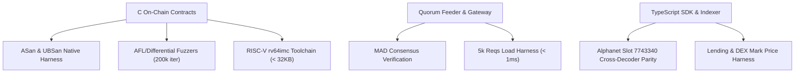

# Formal Invariants Traceability Matrix

Canonical traceability matrix mapping protocol security, economic, and mathematical invariants to their implementation code and automated test coverage.

---

## 1. Traceability Ledger

| Invariant ID | Formal Invariant Definition | Implementation Source | Test Vector & Fuzzer | Target SLA / Bound |
|---|---|---|---|---|
| **INV-1** | **Monotonic Timestamp:** Price updates cannot regress to an earlier timestamp than the previous on-chain slot. | `src/market_oracle.c` `src/v2/oracle_v2.c` | `tests/test_oracle_hardening.c` `tests/test_runtime_assumptions.py` | Fail-closed (`0x200E`) on $T_{\text{new}} < T_{\text{last}}$ |
| **INV-2** | **Circuit Breaker Ceiling:** Raw price deviation within a single update slot cannot exceed allowable delta band. | `src/market_oracle.c` `src/thru_math.c` | `tests/test_oracle_hardening.c` `tests/fuzz_contracts.c` | $\Delta \le 500\text{ bps}$ ($5.00\%$) |
| **INV-3** | **MAD Outlier Filtering:** Spurious venue spikes deviating from median are rejected from consensus aggregate. | `src/v2/aggregation_math.c` `feeder/quorum/aggregator.go` | `tests/test_aggregation_v2.c` `feeder/quorum/aggregator_test.go` | Rejection if $\|P_i - \text{median}\| > 3 \cdot \text{MAD}$ |
| **INV-4** | **Fixed-Point Overflow Safety:** All multiplication, division, exponential, and logarithm ops detect saturation/overflow. | `src/thru_math.c` `include/thru_math.h` | `tests/test_math_checked.c` `tests/fuzz_math_diff.c` | Q64.64 status flags (`Q64_OK`, `Q64_OVERFLOW`) |
| **INV-5** | **Authority Signer Pinning:** Administrative instructions (freeze, resume, upgrade) require authority signature. | `src/market_oracle.c` `src/v2/oracle_v2.c` | `tests/test_contracts.c` `tests/test_sre_drills.ts` | Revert `0x2003` (`UNAUTHORIZED`) |
| **INV-6** | **Bounded Memory Footprint:** Maximum supported assets in on-chain storage array cannot exceed fixed buffer capacity. | `include/market_oracle.h` `sdk/src/encoder.ts` | `tests/test_oracle_hardening.c` `tests/test_sre_drills.ts` | $N \le 32$ symbols; binary size $< 32\text{ KB}$ |
| **INV-7** | **Stale Quote Invalidation:** Off-chain and client consumers reject quotes older than maximum staleness window. | `sdk/src/guards.ts` `gateway/src/routes.ts` | `sdk/test/fixtures.test.ts` `tests/test_partner_consumer.ts` | Max quote age: $120\text{ seconds}$ |
| **INV-8** | **Asymmetric Safe Valuation:** Lending solvency cannot use raw mid-price; collateral is undervalued and debt overvalued. | `sdk/src/client.ts` `sdk/src/guards.ts` | `tests/test_partner_consumer.ts` `sdk/test/client.test.ts` | $P_{\text{collateral}} = P - k \cdot \sigma$ $P_{\text{debt}} = P + k \cdot \sigma$ |
| **INV-9** | **Deterministic RV64IMC ELF:** RISC-V bytecode compilation is bit-reproducible with strict 32 KB page bounds. | `GNUmakefile` `deploy/Dockerfile.reproducible` | `make build-rv64` `scripts/slo_check.sh` | ELF text+data $\le 32,768\text{ bytes}$ |
| **INV-10** | **Idempotent Checkpoint Sync:** Reorgs and replayed transactions resume from highest contiguous slot with zero duplication. | `indexer/src/engine.ts` `indexer/src/db.ts` | `indexer/test/sync.test.ts` `tests/test_sre_drills.ts` | Replay insertion returns `false` |

---

## 2. Verification Harness Summary

