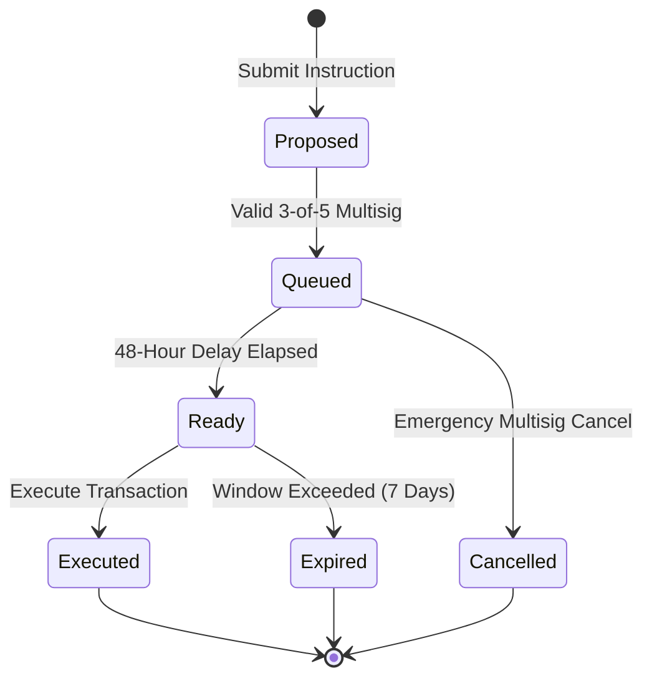

# Upgrade Timelock Governance Specification

Governance rules, delay periods, and emergency intervention mechanics for Thru Quant Core on-chain contracts.

---

## 1. Timelock State Machine

All privileged administrative operations—including code upgrades, publisher whitelist modifications, and risk limit changes—must pass through the on-chain Timelock Controller.

### Delay Parameters

| Parameter | Duration | Rationale |
|---|---|---|
| **Standard Upgrade Delay** | 48 Hours ($172,800\text{ seconds}$) | Allows protocol consumers to audit diffs and pause positions before changes apply. |
| **Execution Window** | 7 Days ($604,800\text{ seconds}$) | Prevents stale proposals from lingering indefinitely. |
| **Emergency Cancel Delay** | Instant ($0\text{ seconds}$) | Allows cold multisig to veto malicious or erroneous queued proposals immediately. |

---

## 2. Protected Instructions

The following operations strictly require timelock clearance:

1. **`ORACLE_INSTR_UPGRADE_PROGRAM`:** Migrating program binary to a new bytecode hash.
2. **`ORACLE_INSTR_SET_ADMIN`:** Two-step handover of the primary governance authority.
3. **`ORACLE_INSTR_ADD_PUBLISHER`:** Granting quote contribution rights to a new operator address.
4. **`ORACLE_INSTR_SET_PARAMS`:** Adjusting basis-point circuit breaker bands (e.g. 500 bps) or staleness thresholds (e.g. 60 seconds).

---

## 3. Transparency & Notification

When a transaction is queued in the timelock:
1. The Indexer emits a `TIMELOCK_QUEUED` event with proposal hash, target instruction, and execution timestamp.
2. Gateway v2 broadcasts the event via SSE on `/v2/governance/stream`.
3. The Web Hub displays a persistent banner highlighting pending governance changes and time remaining until execution.
