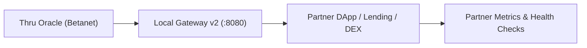

# Design Partner Integration Kit

Integration kit for protocol developers, DEXs, money markets, and automated liquidators integrating Thru Quant Core market data feeds on Thru Betanet.

---

## 1. Overview & Partner Terms

The Design Partner Program provides early-access protocol builders with verified on-chain price feeds and direct engineering support.



### What Design Partners Receive
1. **Zero-Fee Feeds:** Direct access to on-chain Core-6 market feeds (`BTC/USD`, `ETH/USD`, `SOL/USD`, `USDT/USD`, `USDC/USD`, `WTHRU/USD`).
2. **Sub-Millisecond Read Latency:** Access via local Gateway v2 daemon (`:8080`) or zero-dependency binary wire decoder.
3. **Engineering Integration Support:** Architecture review of liquidation engines, margin thresholds, and confidence intervals.

### What is Requested in Return
1. **Technical Feedback:** Bug reports, RPC latency logs, and edge-case reports under extreme market volatility.
2. **Integration Verification:** Executing the integration test harness against protocol contracts prior to mainnet deployment.
3. **Written Case Notes:** Co-published technical summary detailing integration architecture and observed performance.

---

## 2. Integration Checklist

Before deploying contracts relying on Thru Oracle data, verify the following 5 requirements:

- [ ] **1. Pinned Program ID & Accounts:** Hardcode the canonical Betanet program ID (`taWLmuEWcY7nikkn1JB1Whl5nBG1YqWj0oKJMVL8bPbdfR`) and verify account ownership on every read.
- [ ] **2. Asymmetric Valuation in Lending:** Collateral must be evaluated at $P - k \cdot \text{conf}$, and debt at $P + k \cdot \text{conf}$. Never use raw mid-price for loan-to-value solvency.
- [ ] **3. Mark Price Clamping in Perps:** Clamp order book price divergence within $\pm 300\text{ bps}$ of the oracle index price.
- [ ] **4. Volatility Flag Discipline:**
  - `VALID` (`0x00`): Full operation.
  - `BIG_MOVE` (`0x01`): Allow liquidations and limit order fills; apply a 2-slot cooldown to large withdrawals.
  - `LOW_CONF` (`0x02`): Widen liquidation penalty buffer by confidence width.
  - `STALE` (`0x04`) / `CIRCUIT_BREAKER` (`0x08`): Pause liquidations and halt aggressive market execution.
- [ ] **5. Fallback & Timeout Safeguards:** Revert execution fail-closed if daemon read times out (> 500ms) or block timestamp exceeds 60 seconds of age.

---

## 3. Quick Integration Example (TypeScript)

```typescript
import { OracleClient } from "@thru-quant/core-sdk";

const client = new OracleClient({ daemonUrl: "http://localhost:8080" });

const btc = await client.getLatestPrice("BTC/USD");
console.log(`[BTC/USD] $${btc.price} ± ${btc.confidence} (Slot #${btc.slot})`);

const collateral = await client.calculateSafeValuation("ETH/USD", "collateral", { k: 1.0 });
console.log(`Safe Collateral: $${collateral.safePrice} (Raw: $${collateral.rawPrice})`);
```

For detailed protocol playbooks, see:
- [DeFi Lending Playbook](../playbooks/lending.md)
- [Perpetual DEX Playbook](../playbooks/perp-dex.md)
- [Autonomous Agent Guide](../playbooks/autonomous-agents.md)
