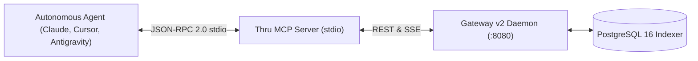
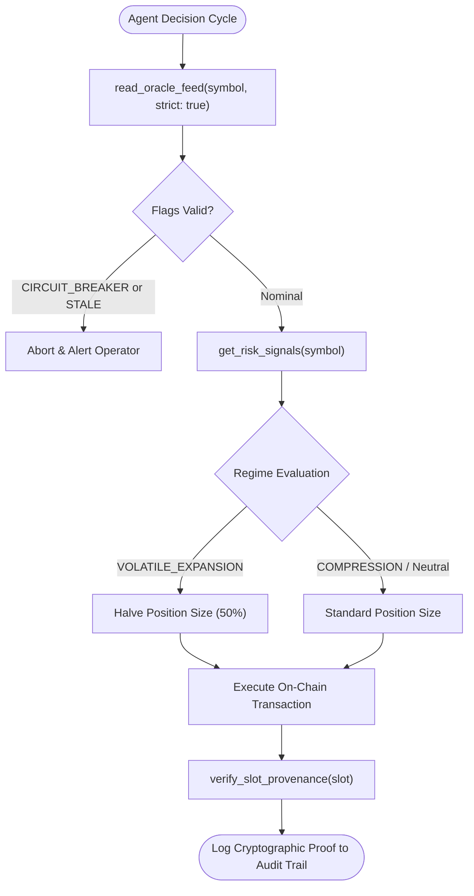

# Autonomous Agent Guide: Integrating Thru Oracle via MCP

This playbook describes how AI trading agents, automated risk managers, and quant bots connect to Thru Quant Core using the Model Context Protocol (MCP).

---

## 1. Overview & Architecture

Autonomous LLM agents require verifiable, real-time market data to execute rebalancing, delta-neutral hedging, and solvency checks without relying on web scrapers or unauthenticated REST calls.

Thru Quant Core exposes a native stdio MCP server (`mcp/dist/index.js`) providing zero-latency oracle inspection tools.



---

## 2. Agent Client Configuration

### Claude Desktop / Antigravity / Cursor Configuration

Add the following to your agent configuration file (e.g. `claude_desktop_config.json` or `~/.cursor/mcp.json`):

```json
{
  "mcpServers": {
    "thru-oracle": {
      "command": "node",
      "args": ["/absolute/path/to/thru_quant_core/mcp/dist/index.js"],
      "env": {
        "THRU_GATEWAY_URL": "http://localhost:8080"
      }
    }
  }
}
```

---

## 3. Available Agent Tools

| Tool Name | Parameters | Returns | Usage |
|---|---|---|---|
| `read_oracle_feed` | `symbol: string`, `strict?: boolean` | `price`, `confidence`, `slot`, `flags`, `publishersCount` | Query current spot consensus price and certainty band. |
| `get_historical_twap` | `symbol: string`, `slots?: number` | `twap`, `samples`, `minPrice`, `maxPrice` | Compute TWAP for low-slippage trade execution. |
| `get_risk_signals` | `symbol?: string` | `volatility15mBps`, `volatility1hBps`, `regime`, `depegBps` | Evaluate rolling market volatility and regime state for position sizing. |
| `verify_slot_provenance` | `slot: number` | `provenanceVerified`, `ed25519SignatureQuorum`, `auditTimestamp` | Cryptographic audit of publisher signatures for on-chain state verification. |

---

## 4. Agent System Prompt Directives

When configuring an autonomous trading agent, inject these rules into the agent prompt:

```markdown
### Oracle Risk Discipline:
1. Always call `read_oracle_feed` with `strict: true` before executing any on-chain trade.
2. If `flags` contains `CIRCUIT_BREAKER` or `STALE`, immediately abort the trade and alert human operators.
3. For collateral valuation, always apply the conservative asymmetric price:
   Safe Price = Price - (1.0 * Confidence)
4. Check `get_risk_signals` before sizing positions:
   - If regime is `VOLATILE_EXPANSION` or 15m volatility > 100 bps, reduce position size by 50%.
   - If regime is `COMPRESSION`, standard position sizing is permitted.
```

---

## 5. End-to-End Agent Execution Flow



1. **Pre-Flight Sanity Check:** Agent invokes `read_oracle_feed(symbol: "ETH/USD")`.
2. **Volatility Evaluation:** Agent invokes `get_risk_signals(symbol: "ETH/USD")`.
3. **Execution Decision:** If `confidenceBps < 20` and volatility is nominal, agent executes trade using the verified price boundary.
4. **Post-Trade Audit:** Agent invokes `verify_slot_provenance(slot: <tx_slot>)` to log cryptographic proof in its decision audit trail.
