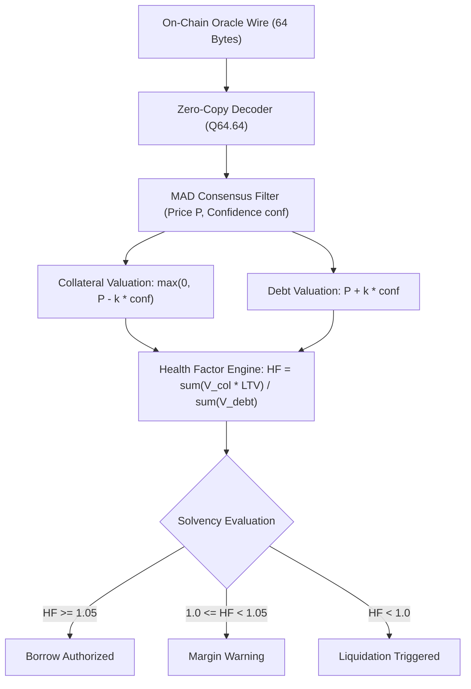

# DeFi Lending Playbook: Conservative Oracle Valuation

This playbook provides the implementation standard for collateral valuation, debt accounting, and liquidation solvency checks using Thru Quant Core v2.

---

## 1. The Asymmetric Confidence Principle

Standard DeFi lending protocols often evaluate collateral and debt using raw spot or median prices. In volatile market conditions or during network congestion, bid-ask spreads widen and oracle uncertainty increases. Evaluating both sides of a loan with a single point estimate exposes the protocol to two fatal failure modes:
1. **Premature liquidation cascades** when collateral is temporarily marked down by transient noise.
2. **Bad debt insolvency** when illiquid collateral is marked up or depreciating debt is marked down.

Thru Quant Core provides an on-chain Median Absolute Deviation (MAD) confidence interval $\text{conf}$ alongside every consensus price $P$. Lending protocols MUST apply asymmetric conservative valuation:

$$\begin{aligned}
V_{\text{collateral}} &= \max(0, P - k \cdot \text{conf}) \\
V_{\text{debt}} &= P + k \cdot \text{conf}
\end{aligned}$$

where $k$ is the protocol risk parameter (typically $k = 1.0$ for standard operations, and $k = 1.4826$ for 95% statistical confidence bounds).



---

## 2. Health Factor Formulation

A user's health factor $HF$ is evaluated conservatively as:

$$HF = \frac{\sum_{i} V_{\text{collateral}, i} \cdot \text{LTV}_i}{\sum_{j} V_{\text{debt}, j}}$$

- **Borrowing Authorized:** If $HF \ge 1.05$ (5% safety buffer above par).
- **Solvent:** If $HF \ge 1.0$.
- **Liquidation Eligible:** If $HF < 1.0$.

---

## 3. Reference Implementation

### TypeScript (Off-Chain Risk Evaluation & Keeper Bot)

```typescript
import { OracleClient } from "@thru-quant/core-sdk";

const client = new OracleClient({ daemonUrl: "http://localhost:8080" });

interface Position {
  collateralAsset: string;
  collateralAmount: number;
  debtAsset: string;
  debtAmount: number;
  liquidationThresholdLtv: number; // e.g. 0.80 for 80%
}

export async function evaluateAccountSolvency(pos: Position) {
  const colVal = await client.calculateSafeValuation(pos.collateralAsset, "collateral", { k: 1.0 });
  const debtVal = await client.calculateSafeValuation(pos.debtAsset, "debt", { k: 1.0 });

  const totalCollateralValueUsd = pos.collateralAmount * colVal.safePrice;
  const totalDebtValueUsd = pos.debtAmount * debtVal.safePrice;

  const maxBorrowAllowedUsd = totalCollateralValueUsd * pos.liquidationThresholdLtv;
  const healthFactor = totalDebtValueUsd > 0 ? maxBorrowAllowedUsd / totalDebtValueUsd : Infinity;

  return {
    collateralPrice: colVal.safePrice,
    debtPrice: debtVal.safePrice,
    totalCollateralValueUsd,
    totalDebtValueUsd,
    healthFactor,
    isLiquidatable: healthFactor < 1.0,
  };
}
```

### C99 (Zero-Copy On-Chain Contract in ThruVM)

```c
#include "thru_quant_core.h"

int evaluate_collateral_c(const thru_oracle_entry_t *entry, uint64_t amount, uint64_t *val_out) {
    if (entry->magic != THRU_ORACLE_MAGIC) return -1;
    if (entry->flags & THRU_FLAG_CIRCUIT_BREAKER) return -2;

    // Fixed-point subtraction with saturating underflow guard
    uint64_t safe_price_q64 = entry->price_q64 > entry->conf_q64 
        ? (entry->price_q64 - entry->conf_q64) 
        : 0;

    // val = amount * safe_price_q64 >> 64
    __uint128_t prod = (__uint128_t)amount * safe_price_q64;
    *val_out = (uint64_t)(prod >> 64);
    return 0;
}
```

---

## 4. Edge Cases & Protocol Safeguards

1. **Flag Handling (`BIG_MOVE`):**
   - When `entry.flags & 0x01` is true, a rapid price dislocation has occurred on-chain.
   - Lending protocols should NOT halt liquidations on `BIG_MOVE`. Liquidations must continue using the safe confidence band to prevent undercollateralization.
2. **Circuit Breaker (`0x08`):**
   - When the circuit breaker trips, new borrowing MUST be suspended immediately. Existing positions remain protected by grace windows.
3. **Stale Data Guard:**
   - Always query feeds with `strict: true` (or check `feedAgeSec <= 60`). Do not execute liquidations on feeds older than 60 seconds.
