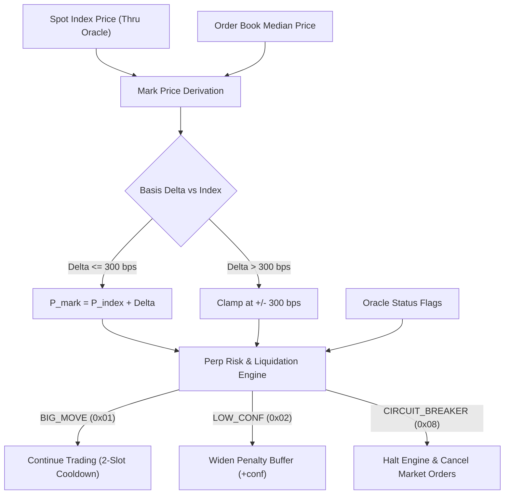

# Perpetual DEX Playbook: Mark Price & Liquidation Mechanics

This playbook details how perpetual derivative exchanges on ThruVM integrate Thru Quant Core v2 for mark price derivation, liquidation risk controls, and funding rate TWAP smoothing.

---

## 1. Index vs. Mark Price Construction

Perpetual exchanges rely on two prices:
1. **Index Price ($P_{\text{index}}$):** The consolidated spot oracle price provided by Thru Quant Core v2.
2. **Mark Price ($P_{\text{mark}}$):** The price used for unrealized PnL and liquidations, designed to prevent flash crashes on thin order books.

Mark price is evaluated by adding a median-smoothed order book basis to the oracle index price:

$$P_{\text{mark}} = P_{\text{index}} + \text{clamp}\left(P_{\text{orderbook\_median}} - P_{\text{index}}, \; -\delta_{\max}, \; +\delta_{\max}\right)$$

where $\delta_{\max} = 300\text{ bps}$ ($3.00\%$). If order book divergence exceeds $\delta_{\max}$, the mark price saturates at the boundary.



---

## 2. Liquidation Mechanics: Flag Discipline

Oracles in high-volatility environments frequently trigger false alarms that freeze trading. Thru Quant Core separates operational volatility markers from systemic failures:

| Oracle Flag | Bit | Meaning | Perpetual DEX Action |
|---|---|---|---|
| `VALID` | `0x00` | Normal consensus | Full trading, liquidations, and margin withdrawals active. |
| `BIG_MOVE` | `0x01` | Price delta > 150 bps in single slot | **DO NOT FREEZE.** Liquidations and limit fills proceed as normal. Margin withdrawals temporarily gated by a 2-slot cooldown. |
| `LOW_CONF` | `0x02` | MAD confidence > 50 bps | Widen liquidation penalty buffer ($\text{buffer} = \text{penalty} + \text{conf}$). Do not liquidate if equity margin > $\text{buffer}$. |
| `STALE` | `0x04` | Feed age > 60 seconds | **Pause liquidations.** Allow limit order cancellations. Require keeper fallback. |
| `CIRCUIT_BREAKER` | `0x08` | Price delta > 500 bps (5%) | **HALT MATCHING ENGINE.** Cancel all aggressive market orders. Await authorized `RESUME` instruction. |

---

## 3. Funding Rate Smoothing via TWAP

Funding rates must not be computed from instantaneous spot prices, as this exposes the protocol to sandwich attacks at the funding hour mark.

Protocols use the `get_historical_twap` MCP tool or SDK history endpoint to compute an 8-hour Time-Weighted Average Price (TWAP):

$$\text{TWAP}_{8\text{h}} = \frac{1}{\sum \Delta t_i} \sum_{i=1}^{N} P_i \cdot \Delta t_i$$

$$\text{Premium Rate} = \frac{\text{TWAP}_{\text{mark}} - \text{TWAP}_{\text{index}}}{\text{TWAP}_{\text{index}}}$$

$$\text{Funding Rate} = \text{Premium Rate} + \text{clamp}(\text{Interest Rate} - \text{Premium Rate}, \; -0.05\%, \; +0.05\%)$$

---

## 4. Implementation Example (TypeScript / Off-Chain Risk Engine)

```typescript
import { OracleClient } from "@thru-quant/core-sdk";

const client = new OracleClient({ daemonUrl: "http://localhost:8080" });

export async function evaluatePositionLiquidation(
  symbol: string,
  entryPrice: number,
  size: number, // positive for long, negative for short
  marginBalance: number,
  maintenanceMarginRatio: number // e.g. 0.05 for 5%
) {
  const quote = await client.getLatestPrice(symbol, { strict: true });

  if (quote.flags & 0x08) {
    return { shouldLiquidate: false, reason: "CIRCUIT_BREAKER_ACTIVE" };
  }

  const pnl = size * (quote.price - entryPrice);
  const equity = marginBalance + pnl;
  const positionNotional = Math.abs(size) * quote.price;
  const maintenanceMarginRequired = positionNotional * maintenanceMarginRatio;

  const confidenceBuffer = (quote.flags & 0x02) ? Math.abs(size) * quote.confidence : 0;
  const effectiveMaintenanceMargin = maintenanceMarginRequired + confidenceBuffer;

  const isLiquidatable = equity < effectiveMaintenanceMargin;

  return {
    markPrice: quote.price,
    confidence: quote.confidence,
    equity,
    maintenanceMarginRequired: effectiveMaintenanceMargin,
    isLiquidatable,
    flags: quote.flagsList,
  };
}
```
