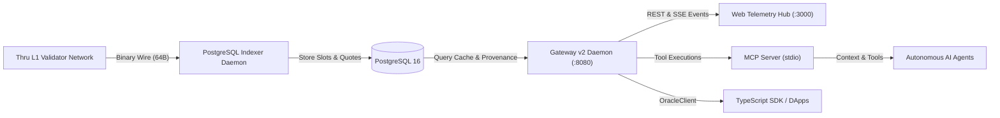

# Thru Quant Core — Developer Quickstart

Integrate decentralized multi-publisher market data, zero-copy MAD consensus prices, and conservative risk guards into your dApp, DeFi lending protocol, or autonomous quant agent in under 5 minutes.

---

## 1. Quick Installation

### Option A: Direct SDK Dependency (TypeScript / ESM)
```bash
npm install @thru-quant/core-sdk
```
Or link locally in this monorepo:
```bash
cd sdk && npm install && npm run build
```

### Option B: Standalone Drop-in
Copy `sdk/dist/thru-oracle.js` into your project. Works in Node.js (v18+), Bun, Deno, or modern browsers with zero external dependencies.

---

## 2. Read Oracle Prices in 3 Lines

```typescript
import { OracleClient } from "@thru-quant/core-sdk";

const client = new OracleClient({ daemonUrl: "http://localhost:8080" });
const quote = await client.getLatestPrice("BTC/USD");

console.log(`[Thru Oracle] ${quote.symbol}: $${quote.price} ± ${quote.confidence} (Slot #${quote.slot})`);
```

---

## 3. DeFi Conservative Valuation (Collateral vs. Debt)

Protocols must evaluate loan-to-value solvency conservatively using the asymmetric confidence interval:

```typescript
import { OracleClient } from "@thru-quant/core-sdk";

const client = new OracleClient({ daemonUrl: "http://localhost:8080" });

// Conservative Collateral: P - k * conf
const col = await client.calculateSafeValuation("ETH/USD", "collateral", { k: 1.0 });
console.log(`Safe Collateral Price: $${col.safePrice} (Raw: $${col.rawPrice})`);

// Conservative Debt: P + k * conf
const debt = await client.calculateSafeValuation("USDC/USD", "debt", { k: 1.0 });
console.log(`Safe Debt Price: $${debt.safePrice} (Raw: $${debt.rawPrice})`);
```

---

## 4. Real-Time Streaming via SSE

Subscribe to continuous on-chain slot updates without polling:

```typescript
const unsubscribe = client.watchFeed("SOL/USD", (update) => {
  console.log(`Live Update: Slot #${update.slot} -> $${update.price} (Flags: ${update.flagsList.join(",")})`);
});

// To disconnect later:
// unsubscribe();
```

---

## 5. Local Services & Telemetry

### Sovereign Stack Architecture



### Running the Full Sovereign Stack

```bash
# 1. Start Gateway v2 API Daemon (Port 8080)
cd gateway && npm run build && npm start

# 2. Launch Sovereign Web Telemetry Portal (Port 3000)
cd web && npm run build && npm start

# 3. Start Model Context Protocol (MCP) Server for AI Agents
node mcp/dist/index.js
```

---

## 6. Integration Playbooks

- [DeFi Lending Playbook](playbooks/lending.md) — Asymmetric confidence bands, health factor derivation, and liquidation thresholds.
- [Perpetual DEX Playbook](playbooks/perp-dex.md) — Mark price smoothing, funding rate TWAP, and volatility flag discipline.
- [Autonomous Agent Guide](playbooks/autonomous-agents.md) — Setting up Claude, Cursor, and LLM trading agents via MCP.
