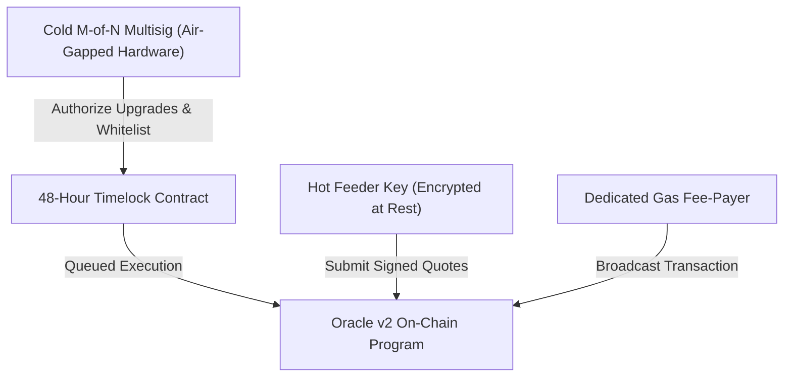

# Cold Key Ceremony & Multisig Governance Runbook

Procedures for cold key generation, M-of-N threshold sharing, emergency key revocation, and role separation for Thru Quant Core on Thru Network.

---

## 1. Role Separation Architecture

Thru Quant Core enforces strict cryptographic role separation to ensure that compromised network hosts cannot modify smart contract logic or steal fees.



| Role | Key Type | Storage Location | Operational Scope |
|---|---|---|---|
| **Cold Admin** | 3-of-5 Ed25519 Multisig | Air-gapped hardware security modules | Contract code upgrades, emergency rebase, publisher whitelist. |
| **Hot Publisher** | Single Ed25519 Keypair | Encrypted at rest (systemd-creds / TPM2) | Periodic price submissions and consensus contribution. |
| **Fee-Payer** | Single Ed25519 Keypair | Online host container | Gas fee payment only; zero governance or quote authority. |

---

## 2. Key Ceremony Protocol

The key ceremony establishes the cold administrative authority without online exposure.

### Step 1: Air-Gapped Workstation Preparation
1. Boot an air-gapped machine using an immutable Linux live distribution (e.g. Tails or Ubuntu Live without networking drivers).
2. Verify hardware RNG integrity (`cat /proc/sys/kernel/random/entropy_avail` $\ge 3000$).
3. Disable all wireless, Bluetooth, and peripheral recording interfaces.

### Step 2: Seed Generation & Shamir Sharding
Execute key generation using standard Ed25519 derivation:

```bash
# Generate 256-bit cryptographic seed
openssl rand 32 > /tmp/admin_master.seed

# Derive public address
thru key derive --seed-file /tmp/admin_master.seed --output /tmp/admin_public.json
```

Split master seed into 5 shares using Shamir's Secret Sharing with a threshold of 3 ($k=3, n=5$):
- Share 1: Security Lead (Hardware token / Safe A)
- Share 2: Operations Lead (Hardware token / Safe B)
- Share 3: Foundation Core (Cold safe, physical vault)
- Share 4: Independent Validator Operator 1 (Encrypted offline)
- Share 5: Independent Validator Operator 2 (Encrypted offline)

### Step 3: Zeroize Working Memory
```bash
shred -u -z -n 7 /tmp/admin_master.seed
sync && reboot -f
```

---

## 3. Emergency Key Rotation Procedure

If a hot publisher key is compromised or a node host is breached:

1. **Detection:** Monitor alert flags `UNAUTHORIZED_SIGNER` or anomaly divergence on `/v2/publishers`.
2. **Immediate Revocation Instruction:**
   Submit `ORACLE_INSTR_REVOKE_PUBLISHER` from the Cold Admin or pre-authorized emergency key.
3. **Backup Key Registration:**
   The affected operator provisions a new keypair using `scripts/onboard_publisher.sh --key-file <new_key>`.
4. **On-Chain Whitelist Update:**
   Admin multisig signs the rotation transaction updating the publisher slot bitmap.
5. **Post-Mortem:**
   Publish incident report within 72 hours with slot timeline and audit proof.
