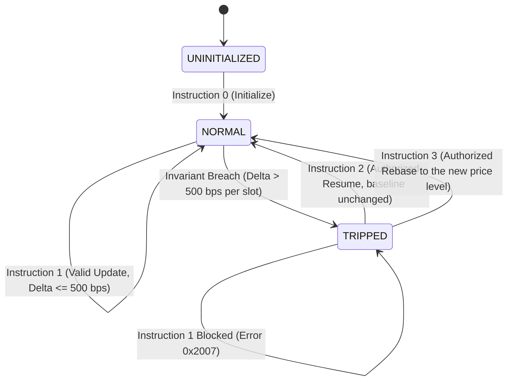

# Thru Quant Core — Formal Protocol & Wire Specification
**Document Standard:** RFC-Style Technical Wire Specification  
**Version:** 1.1.0 (Phase 7 Hardening)  
**Target Architecture:** Thru Network (RISC-V RV64IMC On-Chain Runtime & TypeScript/Go Multi-Runtime)  
**Security Status:** Unaudited (self-reviewed; no third-party audit, see `docs/claims.md` tier 6)  

---

## 1. Abstract & Scope

This specification defines the canonical wire layout, serialization format, mathematical invariants, state machine transitions, and error codes for the **Thru Quant Data & Risk Engine**. 

Downstream client libraries (Go, TypeScript/JavaScript, Rust, C) and smart contracts interacting with the Thru Quant Oracle MUST conform to the exact byte offsets, Little-Endian encoding, and numeric scaling rules defined in this document.

---

## 2. On-Chain Storage Model (Oracle Account)

The Oracle program allocates and persists a fixed-size storage account of exactly **948 bytes** (`oracle_account_data_t`). Packed struct alignment (`__attribute__((packed))`) is strictly enforced; no compiler padding bytes exist between struct members.

### 2.1 Storage Memory Map (Total: 948 Bytes)

| Byte Offset | Size (Bytes) | Field Name | Type | Description |
| :--- | :--- | :--- | :--- | :--- |
| `0x000` - `0x003` | 4 | `version` | `uint32_t` (LE) | State version. Must equal `1`. |
| `0x004` - `0x023` | 32 | `authority_pubkey` | `uint8_t[32]` | Ed25519 public key authorized to update prices or resume. |
| `0x024` | 1 | `circuit_breaker_active` | `uint8_t` | `0x00` = Normal operation; `0x01` = Circuit breaker tripped. |
| `0x025` - `0x027` | 3 | `_reserved` | `uint8_t[3]` | Reserved alignment bytes. Must be zero-filled. |
| `0x028` - `0x02B` | 4 | `regime_id` | `uint32_t` (LE) | Current market regime (0: Neutral, 1: Trending Up, 2: Trending Down, 3: High Vol). |
| `0x02C` - `0x02F` | 4 | `last_update_ts` | `uint32_t` (LE) | Unix timestamp (seconds) of the most recent on-chain publication. |
| `0x030` - `0x033` | 4 | `entry_count` | `uint32_t` (LE) | Number of active asset quotes stored in `entries` ($\le 32$). |
| `0x034` - `0x3B3` | 896 | `entries[32]` | `oracle_entry_t[32]` | Array of 32 asset quote slots ($32 \times 28\text{ bytes} = 896\text{ bytes}$). |

### 2.2 Entry Struct Memory Map (`oracle_entry_t`, 28 Bytes)

Each entry in the `entries` array represents a single market asset quote:

| Relative Offset | Size (Bytes) | Field Name | Type | Description |
| :--- | :--- | :--- | :--- | :--- |
| `0x00` - `0x03` | 4 | `symbol_id` | `uint32_t` (LE) | Numeric asset identifier (1: BTCUSDT, 2: ETHUSDT, ..., 32: BCHUSDT). |
| `0x04` - `0x0B` | 8 | `price_q64_hi` | `uint64_t` (LE) | Integer limb of fixed-point Q64.64 price. |
| `0x0C` - `0x13` | 8 | `price_q64_lo` | `uint64_t` (LE) | Fractional limb of fixed-point Q64.64 price ($0 \le \text{lo} < 2^{64}$). |
| `0x14` - `0x17` | 4 | `volatility_bps` | `uint32_t` (LE) | Rolling log-return volatility in Basis Points ($100\text{ bps} = 1.00\%$). |
| `0x18` - `0x1B` | 4 | `timestamp` | `uint32_t` (LE) | Unix timestamp (seconds) when source quote was captured. |

---

## 3. Transaction Wire Formats

Transactions invoke the Oracle program using Little-Endian packed byte payloads.

### 3.1 Instruction 0: Initialize (`ORACLE_INSTR_INITIALIZE`)
Initializes an unallocated account into a valid Oracle storage state.

| Byte Offset | Size | Field | Value / Constraints |
| :--- | :--- | :--- | :--- |
| `0x00` - `0x03` | 4 | `instruction_type` | `0x00000000` (`uint32_t`) |
| `0x04` - `0x05` | 2 | `oracle_account_idx` | `uint16_t` (Index in transaction account keys) |
| `0x06` - `0x25` | 32 | `seed` | `uint8_t[32]` (Program derivation seed) |

### 3.2 Instruction 1: Update Prices (`ORACLE_INSTR_UPDATE_PRICES`)
Publishes a batch of up to 32 market quotes into the Oracle account.

* **Header Size:** 18 Bytes
* **Total Payload Size:** $18 + (N \times 28)$ Bytes ($N \le 32$, maximum 914 bytes)

| Byte Offset | Size | Field | Value / Constraints |
| :--- | :--- | :--- | :--- |
| `0x00` - `0x03` | 4 | `instruction_type` | `0x00000001` (`uint32_t`) |
| `0x04` - `0x05` | 2 | `oracle_account_idx` | `uint16_t` (Index in transaction account keys) |
| `0x06` - `0x09` | 4 | `regime_id` | `uint32_t` (0 to 3) |
| `0x0A` - `0x0D` | 4 | `timestamp` | `uint32_t` (Max observation timestamp among entries) |
| `0x0E` - `0x11` | 4 | `entry_count` | `uint32_t` ($1 \le N \le 32$) |
| `0x12` - End | $28N$ | `entries` | Packed `oracle_entry_t[N]` |

### 3.3 Instruction 2: Resume Circuit Breaker (`ORACLE_INSTR_RESUME`)
Authorizes resetting a tripped circuit breaker back to `NORMAL` state (`circuit_breaker_active = 0`).

* **Total Payload Size:** Exactly 6 Bytes
* **Canonical Wire Hex:** `020000000200` (when `oracle_account_idx = 2`)

| Byte Offset | Size | Field | Value / Constraints |
| :--- | :--- | :--- | :--- |
| `0x00` - `0x03` | 4 | `instruction_type` | `0x00000002` (`uint32_t`) |
| `0x04` - `0x05` | 2 | `oracle_account_idx` | `uint16_t` |

### 3.4 Instruction 3: Rebase (`ORACLE_INSTR_REBASE`)
Authority-only recovery for a **genuine re-pricing**. Valid only while `circuit_breaker_active = 1` (otherwise `0x2011`). The payload layout is identical to Instruction 1 (§3.2) with `instruction_type = 0x00000003`. All structural, clock, timestamp, symbol and price validations of §5 apply; only the deviation check is skipped. On success the entries are written as the new baseline, `last_update_ts`/`regime_id` are updated and `circuit_breaker_active` is cleared in the same transaction.

Use `RESUME` (Instruction 2) only when the stored baseline is still correct (e.g. a rejected fat-finger). If the market has genuinely moved by more than the breaker limit, `RESUME` alone re-trips on the next update because the stored baseline is unchanged; use `REBASE`.

---

## 4. Numeric Invariants & Arithmetic Specification

### 4.1 Fixed-Point Q64.64 Arithmetic
To eliminate floating-point non-determinism across disparate CPU architectures (RISC-V, x86_64, ARM64), all prices are stored as 128-bit unsigned fixed-point numbers with 64 integer bits and 64 fractional bits:
$$P = \text{price\_q64\_hi} + \frac{\text{price\_q64\_lo}}{2^{64}}$$

### 4.2 Arbitrary-Precision Decimal Conversion Algorithm
Downstream financial applications MUST convert Q64.64 to standard decimal strings using integer scaling to avoid IEEE-754 mantissa truncation:
$$\text{scale} = 10^D$$
$$\text{fracScaled} = \left\lfloor \frac{\text{lo} \times \text{scale} + 2^{63}}{2^{64}} \right\rfloor$$
$$\text{PriceDecimal} = \text{hi}.\text{padStart}(\text{fracScaled}, D)$$

### 4.3 Volatility Metric
Volatility is expressed as Basis Points ($1\text{ bps} = 0.01\%$) computed from 10-sample rolling log-returns:
$$r_t = \ln\left(\frac{P_t}{P_{t-1}}\right), \quad \sigma = \sqrt{\frac{1}{N-1}\sum_{t=1}^N (r_t - \bar{r})^2}, \quad \text{Bps} = \min(10000, \lfloor \sigma \times 10000 \rfloor)$$

---

## 5. Timing, Staleness & Replay Rules

1. **Maximum Quote Age (`MAX_QUOTE_AGE_SECONDS = 120`):**
   - The program rejects an update whose header timestamp is more than 120 s behind block time (`0x2009`) and any entry more than 120 s behind the header timestamp (`0x200E`).
   - Consumers MUST additionally apply the 120 s rule to every quote at read time; stored quotes age while the oracle is idle or tripped.
2. **Maximum Future Clock Skew (`MAX_FUTURE_SKEW_SECONDS = 30`):**
   - A header timestamp more than 30 seconds ahead of block time triggers error `0x200A` (`FUTURE_SKEW`).
3. **Clock availability (fail-closed):**
   - If the block clock is unavailable (null block context or `block_time == 0`) the update is rejected with `0x200D`. Time checks are never skipped.
4. **Timestamp consistency:**
   - Header `timestamp` MUST be `>= last_update_ts` (`0x2009`) and MUST equal the maximum entry timestamp (`0x200E`).
   - Each entry `timestamp` MUST be `<= header timestamp` and `>=` the stored timestamp of the same `symbol_id` (`0x200E`). Feeders MUST drop a quote rather than fabricate or regress its timestamp.
5. **Monotonic Sequence Enforcement (clients):**
   - Client applications MUST reject any update where `last_update_ts < previous_last_update_ts` to prevent stale RPC cache replay anomalies.
6. **Atomicity:**
   - All validations run before any write; a rejected update leaves account state byte-identical. Updates that would exceed 32 symbols are rejected (`0x200F`), never silently truncated.

---

## 6. Circuit Breaker Lifecycle

### Trigger Invariants:
- A price deviation exceeding **500 Basis Points (5.00%)** versus the last accepted quote of the same symbol (compared exactly, no integer flooring) sets `circuit_breaker_active = 1`. The offending batch is **not** applied.
- While tripped, all subsequent price updates are blocked with error `0x2007`. Recovery is `RESUME` (baseline unchanged) or `REBASE` (new baseline), see §3.3-§3.4.
- Downstream protocols MUST immediately freeze automated margin liquidations while the circuit breaker is active.

---

## 7. Error Register (0x2001 - 0x2013)

| Error Code (Hex) | Decimal | Symbolic Identifier | Cause | Client Recovery Action |
| :--- | :--- | :--- | :--- | :--- |
| `0x2001` | 8193 | `ORACLE_ERR_INVALID_INSTR_SIZE` | Payload length does not match expected struct size. | Check payload buffer length before submission. |
| `0x2002` | 8194 | `ORACLE_ERR_INVALID_INSTR_TYPE` | Unknown `instruction_type` ($> 3$). | Ensure instruction type is 0, 1, 2, or 3. |
| `0x2003` | 8195 | `ORACLE_ERR_UNAUTHORIZED` | Transaction signer does not match `authority_pubkey`. | Sign transaction with authorized oracle authority key. |
| `0x2004` | 8196 | `ORACLE_ERR_DATA_ACCESS_FAILED` | ThruVM storage account pointer returned NULL. | Verify account index and program permissions. |
| `0x2005` | 8197 | `ORACLE_ERR_ACCOUNT_INIT_FAILED` | Account initialization write failed. | Ensure account is owned by Oracle program. |
| `0x2006` | 8198 | `ORACLE_ERR_INVALID_COUNT` | `entry_count` exceeds 32 or equals 0. | Clamp symbol updates to $1 \le N \le 32$. |
| `0x2007` | 8199 | `ORACLE_ERR_CIRCUIT_BREAKER` | Price update attempted while breaker is active. | Submit authorized `RESUME` instruction (type 2). |
| `0x2008` | 8200 | `ORACLE_ERR_ALREADY_INITIALIZED` | Initialize called on an already active account. | Do not re-initialize existing accounts. |
| `0x2009` | 8201 | `ORACLE_ERR_STALE_TIMESTAMP` | Header timestamp is older than the previous update, or more than 120 s behind block time. | Ensure ingestion timestamps advance and the feeder clock is synchronized. |
| `0x200A` | 8202 | `ORACLE_ERR_FUTURE_SKEW` | Quote timestamp exceeds local clock by $> 30$s. | Synchronize system clock with NTP before feeding. |
| `0x200B` | 8203 | `ORACLE_ERR_DUPLICATE_SYMBOL` | Multiple quotes with the same `symbol_id`. | Deduplicate symbols in the update array. |
| `0x200C` | 8204 | `ORACLE_ERR_INVALID_PRICE` | Quote price is zero (`hi = 0` and `lo = 0`) or `price_q64_hi >= 2^63`. | Validate market feed price $> 0$ before packing. |
| `0x200D` | 8205 | `ORACLE_ERR_CLOCK_UNAVAILABLE` | Block clock unavailable (null context or `block_time == 0`). | Retry later; the update is rejected fail-closed. |
| `0x200E` | 8206 | `ORACLE_ERR_ENTRY_TIMESTAMP` | Entry timestamp ahead of header, >120 s behind it, older than the stored quote of that symbol, or header != max(entry timestamps). | Drop the quote instead of fabricating or regressing its timestamp. |
| `0x200F` | 8207 | `ORACLE_ERR_SYMBOL_CAPACITY` | Update would add symbols beyond the 32 slots. | Remove symbols or deploy a larger oracle account. |
| `0x2010` | 8208 | `ORACLE_ERR_INVALID_SYMBOL` | `symbol_id == 0`. | Use `symbol_id >= 1`. |
| `0x2011` | 8209 | `ORACLE_ERR_NOT_TRIPPED` | `REBASE` submitted while the breaker is not tripped. | Use `UPDATE_PRICES` (type 1). |
| `0x2012` | 8210 | `ORACLE_ERR_INVALID_REGIME` | `regime_id > 3`. | Clamp regime to 0..3. |
| `0x2013` | 8211 | `ORACLE_ERR_RESIZE_FAILED` | Account resize failed during initialization. | Check account size and permissions. |
