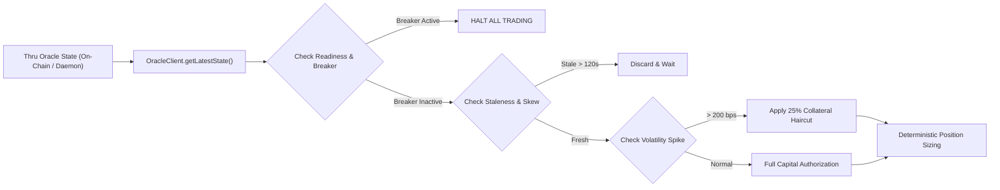

# Autonomous Quant Risk-Agent Consumer Example

This example demonstrates how an autonomous algorithmic execution engine, lending liquidation bot, or DeFi protocol consumes real-time market data and risk signals from the **Thru Quant Data & Risk Engine**.

---

## 1. Architecture & Flow



---

## 2. Risk Invariants Implemented

1. **Circuit Breaker Trip Invariant:**
   - If `state.circuitBreakerActive === true`, the agent immediately halts all trade processing and issues an emergency alert.
2. **Monotonic Sequence / Anti-Replay Safeguard:**
   - Detects timestamp regression (`currentTs < lastProcessedTs`) to protect against cached RPC replay attacks.
3. **Volatility-Adjusted Margin Haircuts:**
   - Dynamically expands collateral requirements and trims capital allocation by 25% during volatility spikes (> 200 bps).
4. **Sub-Satoshi Fixed-Point Precision:**
   - Uses exact `BigInt` scaling via `q64ToDecimalString` for deterministic execution accounting.

---

## 3. How to Run

### Standalone Dry-Run (Zero External Dependencies)
Runs a simulated deterministic execution against the canonical Alphanet Slot 7743340 fixture:
```bash
node agent.ts --dry-run
```

### Live Polling Mode
Polls the local Go HTTP daemon (`http://localhost:8082`) with automatic failover to Thru Alphanet JSON-RPC:
```bash
node agent.ts
```
